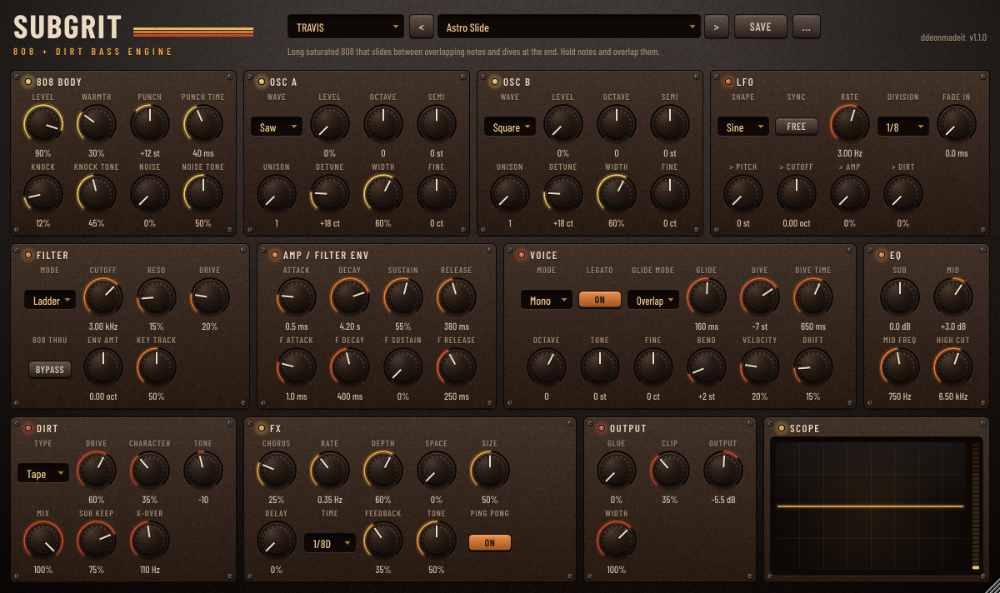
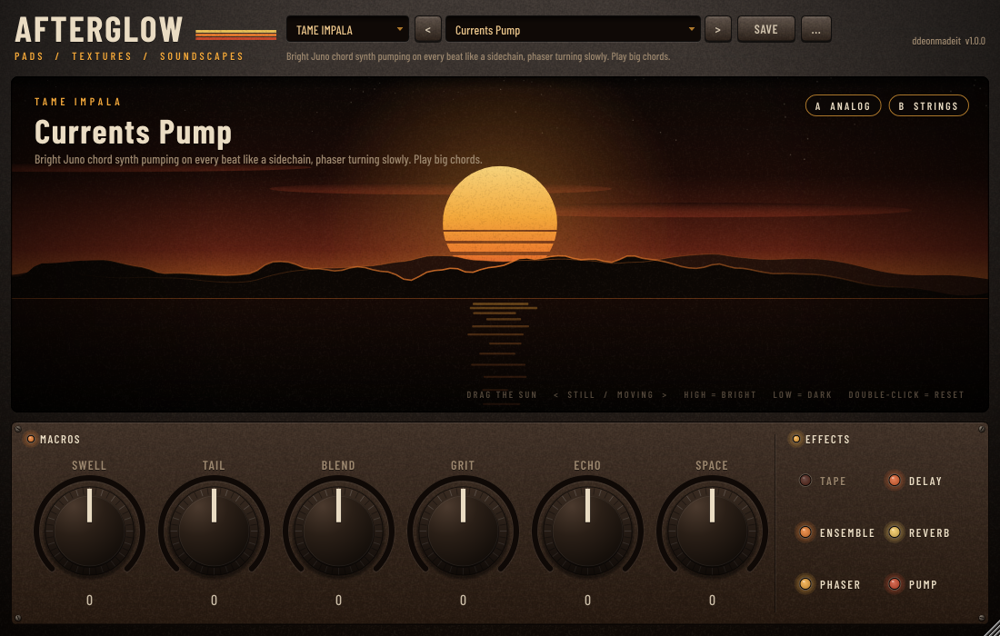
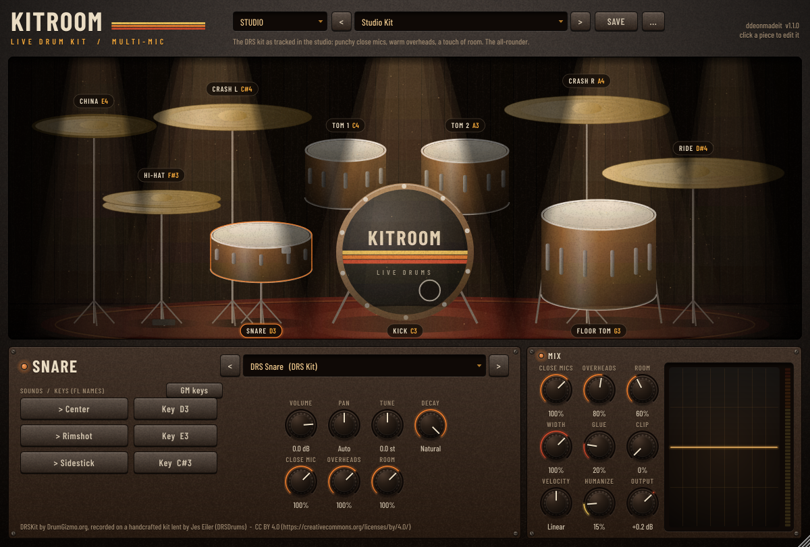

# ddeonmadeit plugins

Audio plugins for FL Studio on macOS (VST3 + AU, universal: Apple Silicon and Intel).

**Download: https://ddeonmadeit.github.io/plugins-/** (always the newest version of every plugin,
with audio previews of the presets).

## SubGrit: 808 + distorted bass

A bass synth built for grungy, distorted, *still-full* 808s and synth basses, with 58 presets in
five styles: **TRAVIS**, **MIKE DEAN**, **UNTILJAPAN**, **YE** and **BOUNCE 808**.



**Why the distortion stays full:** the Dirt section distorts at 4x oversampling, then splits the
signal at the Sub X-Over. You hear the grit above it; below it, **Sub Keep** blends the clean,
phase-aligned sub back in. Drive as hard as you like and the low end doesn't thin out. Below 200 Hz
the output is always mono, so it hits the same on club systems and phones.

### Sound engine

- **808 Body**: phase-reset sine (every hit identical), Warmth (rounds it toward a square), Punch
  (pitch drop at the start), Knock (click transient), Noise.
- **Osc A / Osc B**: band-limited saw, square, pulse, triangle and sine with up to 7-voice unison,
  detune, stereo width, octave, semi and fine.
- **Filter**: zero-delay-feedback 4-pole ladder (Moog style) with drive, plus 12 dB LP/BP/HP,
  its own envelope and key tracking. "808 Thru" puts the body through the filter too.
- **Voice**: mono with 808-style choke or poly, legato glide (overlap notes to slide) or always-glide,
  **Dive** (pitch drop after you release the note), pitch bend range, velocity, analog drift.
- **LFO**: free or tempo-synced, fade-in (delayed vibrato), to pitch, cutoff, amp (pulses) and dirt.
- **Dirt**: Tape, Tube, Fuzz, Clip, Fold, Crush, Rectify and Amp, with Character, Tone, Mix,
  Sub Keep and X-Over. Level is auto-compensated, so Drive changes the tone, not the volume.
- **EQ, FX, Output**: sub shelf, mid bell, high cut; chorus, tempo-synced ping-pong delay and a
  reverb ("Space") that only touch content above 200 Hz; glue compressor; 4x-oversampled clipper; width.
- Presets are loudness-matched, so switching between them compares tone, not volume.

### Presets

**TRAVIS** (12): dark, psychedelic, sliding, tape/fuzz grit with a huge sub; Utopia-era rage

| Preset | What it is |
| --- | --- |
| Astro Slide | Long saturated 808 that slides between overlapping notes and dives at the end. Hold notes and overlap them. |
| Rage Fuzz 808 | FE!N-style rage 808: fuzz with an octave-up buzz layer, sliding and sustaining under the sub. |
| Highest Haze | Deep tube-warm sub with a psychedelic chorus-and-space halo on the harmonics only. |
| Utopia Grit Saw | Rectified, filtered saw stack riding a heavy sub. Dark and wide, gritty mid growl. |
| The Pulse | Resonant saw bass chopped into 1/16 pulses by the synced LFO, washed in chorus. Hold long notes. |
| Sicko Knock | Hard-hitting beat-switch 808: big punch, loud knock, tube-driven mids. Short and bouncy. |
| Cactus Drift | Psychedelic drifting bass: detuned tri + saw, slow filter wobble, deep chorus and space. |
| Goosebumps Low | Dark tube 808, rounded body, everything above 2.8 kHz rolled off. Late-night and heavy. |
| Antidote Dive | Round, squared-off 808 that glides on every note (Always mode) and drops an octave when released. |
| Mosh Pit Clip | Squared-off rage 808: the body is nearly a square wave before it even hits the clipper. |
| Jackboys Bounce | Mid-length bouncy 808 with tape grit and a little knock. Works on fast hi-hat beats. |
| Flame Wobble | The 808 itself runs through a driven ladder filter that wobbles in eighth-note triplets. Psychedelic. |

**MIKE DEAN** (12): Moog-style analog synth bass: driven ladder filter, portamento, vibrato, delay throws

| Preset | What it is |
| --- | --- |
| Grandmother Low | Clean, plucky analog bass: saw + sub-square through a ladder with a quick envelope blip. |
| Model D Growl | Two detuned saws with the ladder slammed and resonant: a fat, snarling, slow-opening growl. |
| 4:20 Fuzz Bass | Fuzzed saw stack with a dotted-eighth delay throw. Loud, analog and a little unhinged. |
| Matriarch Throw | Square + saw ladder bass with long ping-pong delay throws on the harmonics. Play sparse. |
| Saturn Analog 808 | 808 body with a ladder-filtered saw blip on every hit. 808 weight, synth attitude. |
| Oberheim Wide | Lush unison saws an octave apart in a 12 dB filter, chorused wide. Big chord-friendly bass. |
| Synth God Vibrato | Lead-bass: saw over a sine sub through a warm ladder, with delayed vibrato and a quarter-note echo. |
| Dean Amp 808 | 808 pushed through an amp-style distortion with a 1 kHz honk that cuts on any speaker. |
| Acid Ladder | Squelchy resonant saw with a snappy filter envelope. Velocity opens it up. |
| Slow Sweep | The filter slowly opens over a second: hold a note and ride the sweep. Cinematic analog bass. |
| DFAM Thump | Percussive analog kick-bass: huge pitch drop, noise snap, short decay. Program it like drums. |
| Synth God Square | Hollow square sub with a soft wavefold sheen and a quiet dotted delay. Smooth but present. |

**UNTILJAPAN** (10): cinematic, polished, heavy and echoed; lo-fi textures and dark space

| Preset | What it is |
| --- | --- |
| Trompe Echo 808 | Heavy tape 808 whose harmonics echo in dotted eighths while the sub stays dry and centred. |
| Pyramid Weight | Enormous sub-first 808 with subtle fold harmonics. The low end is the whole point. |
| Coast Haze | Rectified grit drowned in slow chorus and a big space, sub kept clean underneath. Dreamy and dark. |
| Helluva Crush | Bit-crushed, decimated 808 grit with a quarter-note echo. Lo-fi but still heavy. |
| Wolf Skin | Lo-fi cinematic 808: lightly crushed, with a dark saw shadow whose filter breathes slowly, plus echo. |
| Cinema Sub | Polished, glued sub with a slow pitch dive on release and a distant tail. Expensive and clean. |
| Night Drive | Detuned square bass with echo throws spreading wide. Rolling, late-night energy. |
| Underground Rattle | Raspy rectified 808 that rattles in the mids. Short, aggressive, built for cuts through hats. |
| Glass Echo | Bright wavefolded overtones bouncing in ping-pong eighths above a solid sub. |
| Phantom Glide | Ghostly 808 with delayed vibrato, slow octave sink on release and long dark echoes. |

**YE** (12): 808s & Heartbreak boom, Yeezus industrial, Donda stadium, Vultures clipping

| Preset | What it is |
| --- | --- |
| Heartbreak Boom | Classic long TR-808 boom: soft pitch bow, almost clean, rings for seconds. 808s & Heartbreak era. |
| Skinhead Industrial | Yeezus industrial stabs: square + saw through an amp with noise, the drive stuttering in 16ths. |
| On Sight Acid | Buzzing resonant acid saw, wavefolded and bright. Yeezus electronic aggression. |
| New Slaves Growl | Low fuzzed saw growl with the filter pumping in half notes. Ominous and huge. |
| Vultures Clip | Ultra-clipped Vultures 808: flat-topped, loud, crunchy, with the sub still holding the floor. |
| Carnival Stomp | Crowd-stomp 808: rectified octave rasp, giant knock, short and slamming. |
| Donda Organ Sub | Organ-like sustained sub: sine plus octave and twelfth drawbars, a soft attack and a big room. |
| Off The Grid 808 | Hollow, wavefolded drill 808 with a sharp knock and quick slides between overlapping notes. |
| Jail Amp | Rock-amp distortion on a sliding, saw-layered 808 that holds. Bright, heavy and rude. |
| God Crush | Harsh bit-crushed bass with a square layer and a nasal 1 kHz edge. I Am a God energy. |
| Stronger Saw | Bright Graduation-era synth bass: unison saws, snappy 12 dB filter, light chorus. |
| Stadium 808 | Donda stadium 808: fuzzed overtones thrown into a huge hall while the sub punches dry. |

**BOUNCE 808** (12): regular bouncy 808s: punchy, knocking, sliding, clean subs, phonk

| Preset | What it is |
| --- | --- |
| Classic 808 Long | Round TR-808 boom with a gentle punch and tape warmth. The default 808. |
| Bounce Knock | Short, punchy 808 with a loud knock on top. Program fast and syncopated. |
| Metro Sub | Clean, round, sustained sub with legato slides. Sits under anything. |
| Southside Grit | Dark, heavily taped 808 with a knock, clipped for weight. Gritty but bouncy. |
| Trap House Bounce | Snappy, short tube 808 with a fast pitch kick. Pure bounce. |
| Drill Slide | UK/NY drill 808: long legato glides, warm body, slight dip at the end. Overlap your notes. |
| Pluggnb Soft | Soft, rounded, low-passed 808 with long, smooth slides. Melodic and gentle. |
| Detroit Punch | Kick-like 808 with a big pitch snap and a sharp knock. Short and loud. |
| Memphis Phonk | Phonk 808: deeply wavefolded and clipped, ringing long and buzzing in the mids. |
| Rubber Band | Bouncy 'boing' 808: a slow pitch fall makes every hit spring back. Short notes. |
| Deep Sine Clean | Utility pure sine sub. No grit: drop it under anything that needs weight only. |
| Juicy Mid 808 | Tube 808 plus an octave harmonic and an 800 Hz lift so it reads on phone speakers. |

### Install (Mac)

1. Get the `.pkg` (or the `.zip`) from the [download page](https://ddeonmadeit.github.io/plugins-/)
   or this repo's **Releases** page.
2. Double-click the `.pkg`. The first time, macOS says it can't verify the developer: open
   **System Settings > Privacy & Security**, click **Open Anyway**, then run the `.pkg` again.
   *No admin password?* Unzip the `.zip` and run `bash ~/Downloads/SubGrit-1.0.0-macOS/Install.command` in Terminal.
3. In FL Studio: **Options > Manage plugins > Find more plugins**. SubGrit shows up under **Generators**.

**Playing:** notes play at their real pitch. In FL Studio's piano roll the classic 808 range is
**C2–C3** (about 33–65 Hz). Use **Voice > Octave** if you'd rather play higher. Overlap notes to
slide on presets with glide; leave gaps for clean re-hits.

User presets are saved to `~/Music/ddeonmadeit/SubGrit/Presets` (SAVE button; "..." menu reveals
the folder).

## Afterglow: pads, textures and soundscapes

A synth for pads, strings, ear candy, textures and soundscapes, built to be played rather than
programmed: the window is a sunset, and the sun is the controller. Drag it left-right for **Motion**
(still to moving: vibrato, phaser, tape wobble, drift) and up-down for **Tone** (bright and high, or
dark and sinking). Six macros reshape any preset: **Swell**, **Tail**, **Blend**, **Grit**, **Echo**,
**Space**. Centre is always the preset as designed.



- **Two layers per voice**, each one of seven sources: Analog (Juno / Prophet saws with PWM), Strings
  (string machine), Choir (formant vowels with breath), Glass (FM bells), Tines (electric piano), Air
  (pitched breath) and Sine. Up to 7-voice unison, drift, filter (ladder or SVF), two envelopes, two LFOs,
  poly / mono / legato with glide.
- **Effects** (lamps on the panel): tape wow, flutter and saturation, lo-fi, Juno / Solina ensemble,
  phaser, tape-style dub delay, a long reverb with shimmer, and a tempo-synced pump or gate. The low
  end always stays mono.
- **50 presets** in five styles, ten each: **TAME IMPALA** (phased Juno synths, Currents pump, glide leads),
  **MASSIVE ATTACK** (dark trip-hop pads, dub echoes, drones, strings), **BRENT FAIYAZ** (Rhodes, airy
  choirs, soft lo-fi), **MIKE DEAN** (Moog / Prophet leads and brass, cinematic swells) and **TRAVIS SCOTT**
  (eerie bells, flutes, gated choirs, crushed drones). Loudness-matched.

## Kitroom: live acoustic drum kit

A real drum kit, every piece on its own key, recorded with close, overhead and room mics. No
synthesized or electronic drums: every sound is a multi-mic recording of an acoustic kit (DrumGizmo's
DRSKit and MuldjordKit, CC BY 4.0), with 10 to 60 velocity layers per articulation and round robin,
so repeated hits never sound like the same sample.



- **The kit on screen**: click any piece to hear it and edit it. Pieces flash when played and show
  their key in FL Studio note names.
- **Swap any piece**: each slot takes any recorded sound of its kind (four kicks including a deadened
  one, three snares including brushes, three hi-hats, ten toms, five crashes and a china, five rides).
- **One piano roll**: kick C3, snare D3, sidestick C#3, hi-hat F#3 closed / G#3 pedal / A#3 open / B1
  half-open, toms C4 / A3 / G3, crashes C#4 / A4, ride D#4, bell F4, china E4 (General MIDI). Any key
  can be re-learned from your keyboard; "GM keys" resets them.
- **Mix like a recording**: per piece volume, pan, tune, decay and close / overhead / room mic level;
  for the kit, the three mic buses, width (lows always mono), glue compressor, clipper, velocity curve
  and humanize. Close mics follow where each piece sits in the overheads, so the stereo image holds.
- **17 presets**: STUDIO, LIVE ROOM, VINTAGE (dry 70s, jazz brushes and sticks, Motown), TIGHT (funk,
  neo soul, punch rock) and BIG (big room, arena, crushed room), loudness-matched.

The installer also puts the sound library (about 230 MB) in
`/Library/Application Support/ddeonmadeit/Kitroom/Library`. User presets go to
`~/Music/ddeonmadeit/Kitroom/Presets` and remember the sound chosen for each piece.

## Building

```bash
cmake -B build -G Ninja -DCMAKE_BUILD_TYPE=Release
cmake --build build --target SubGrit_VST3 SubGrit_Standalone   # + SubGrit_AU on macOS
tools/qa/run_qa.sh SubGrit                                      # offline audio QA
```

macOS installers are built by GitHub Actions (`.github/workflows/build.yml`) on every push; a tag like
`SubGrit-v1.0.0` publishes that plugin's Release and updates the download page. See `CLAUDE.md` for the
repo layout and how to add plugins.

JUCE is used under the AGPLv3 / JUCE 9 licence terms.
